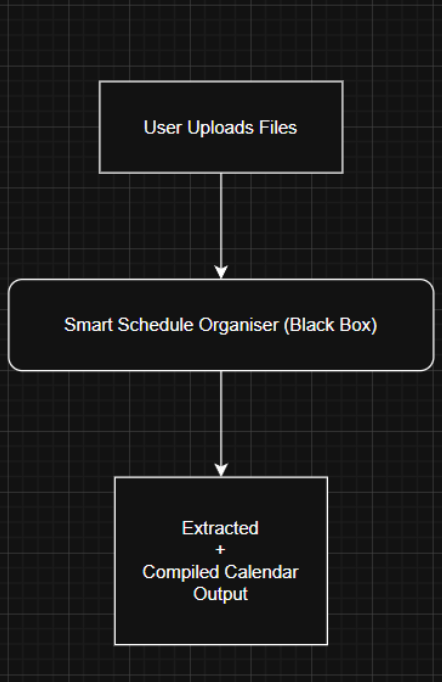
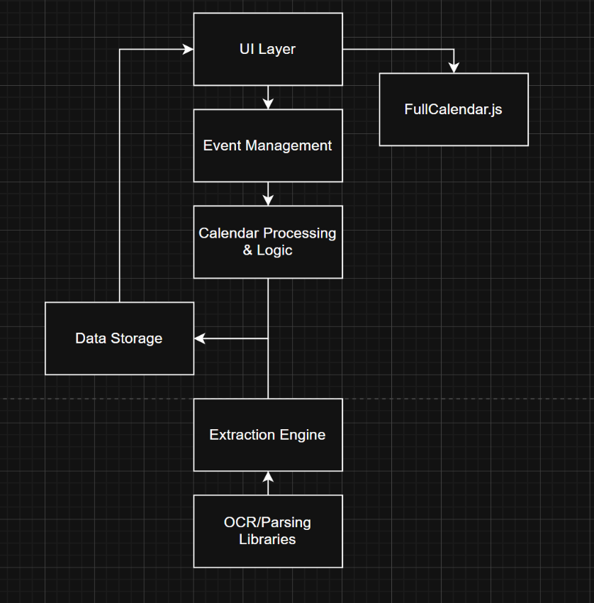

# Software Requirements Specification (SRS)
## Smart Calendar System

---

## Table of Contents

1. [Introduction](#1-introduction)  
   1.1 [Overview](#11-overview)  
   1.2 [Business Context](#12-business-context)  
   1.3 [Glossary](#13-glossary)

2. [General Description](#2-general-description)  
   2.1 [Product Perspective](#21-product-perspective)  
   2.2 [Product Functions](#22-product-functions)  
   2.3 [User Characteristics](#23-user-characteristics)  
   2.4 [Constraints](#24-constraints)  
   2.5 [Assumptions and Dependencies](#25-assumptions-and-dependencies)  
   2.6 [Apportioning of Requirements](#26-apportioning-of-requirements)

3. [Specific Requirements](#3-specific-requirements)  
   3.1 [External Interfaces](#31-external-interfaces)  
   3.2 [Functions](#32-functions)  
   3.3 [Logical Database Requirements](#33-logical-database-requirements)

4. [System Architecture](#4-system-architecture)

5. [High Level Design](#5-high-level-design)

6. [Preliminary Schedule — Gantt Chart](#6-preliminary-schedule)

7. [Appendices](#7-appendices)

---

# 1. Introduction

## 1.1 Overview
The Smart Calendar system is a web-based system designed to automate the extraction and organisation of scheduling information from a variety of file formats. Its core purpose is to minimise manual data entry by interpreting structured and unstructured documents such as spreadsheets, PDFs, screenshots, text files, and other sources. The system converts extracted information into structured calendar events that can be displayed, edited, validated, and exported by the user.

The system’s overall goal is to improve efficiency, reduce transcription errors, and support users who need to consolidate timetables, work schedules, or other time-based information into a unified format.

## 1.2 Business Context
This software is developed within an academic environment as part of a university module on software engineering. There is no external customer, and no commercial or contractual requirements apply.
The project serves as a demonstration of requirements engineering, system design, data processing, and user interface development.
Although academically motivated, the system concept applies to real-world scenarios such as academic timetabling, workflow scheduling, and personal productivity applications.

## 1.3 Glossary
- **API (Application Programming Interface):** A set of rules that allows different software components to communicate with each other.
- **UI (User Interface):** The visual part of the system that the user sees and uses to interact with the application.
- **OCR (Optical Character Recognition):** Technology used to convert images or scanned documents into machine-readable text.
- **ICS File:** A standard calendar file format used to exchange calendar information between systems.
- **ER Diagram (Entity Relationship Diagram):** A diagram showing the logical structure of a database including entities, attributes, and relationships.
- **<mark>FullCalendar.js</mark>:** A JavaScript library used to display and interact with calendars in web applications.
- **Parsing:** The process of analyzing text to extract structured information such as dates and event titles.
- **Conflict Detection:** The process of identifying overlapping or incompatible events within a calendar.
- **Extraction Engine:** The component responsible for converting uploaded files into structured event data.
- **Application Layer:** The part of the system that contains the business logic and connects the UI with data processing.
- **Data Storage Layer:** The part of the system responsible for storing events, files, and extracted data in a database.
- **JSON (JavaScript Object Notation):** A lightweight data format used for transmitting data between server and client.
- **Tesseract:** An open-source OCR engine used for extracting text from images.
- **PDFMiner:** A Python library used for extracting text from PDF documents.
- **Gantt Chart:** A project management chart showing tasks over time.

---

# 2. General Description

## 2.1 Product Perspective
The Smart Calendar system operates as an independent web-based system. It is not part of a larger enterprise environment and does not depend on legacy systems. Its primary role is to ingest user-provided files, extract scheduling information, and present it in a unified calendar format.

The system is comparable to existing calendar tools but is distinguished by its emphasis on automated interpretation of semi-structured and unstructured inputs. Unlike standard calendar applications, which typically rely on manual user entry or fully formatted calendar files, this system is designed to process a wide range of different kinds of documents with minimal user intervention.

A simplified block representation of the system in context is shown below. Internal design details are described in later documents:

### System Block Diagram

### 2.1.1 System Interfaces
The system interacts with the following external systems:
- **Google Calendar API:**
  - **Purpose:** Enables authenticated export of events.
  - **Capability:** One-way export only; the system does not import or synchronise external calendars.
- **Local File System:**
  - **Purpose:** Allows users to upload files for processing.
  - **Capability:** Supports standard desktop file selection; no continuous connection or third-party file repository is required.

If these systems are unavailable, the core application remains functional through local ICS export.

### 2.1.2 User Interfaces
The system provides a browser-based graphical interface with the following features:
- File upload panel for document ingestion
- Calendar display (day/week/month views)
- Event validation and editing interface
- Options for exporting calendar data
- Pop-up prompts for validation and event editing

The interface targets users with general computer literacy. No command-line interface is provided. Accessibility requirements beyond general usability (e.g., specialised compliance standards) are not explicitly mandated.

### 2.1.3 Hardware Interfaces
The system has no dedicated hardware interfaces.
- It operates on standard computing devices using keyboard and mouse input.
- No external hardware components or peripherals are required.

### 2.1.4 Software Interfaces
Relevant software interfaces include:
- **Google Calendar API:** Used for authenticated calendar export. Communicates via HTTPS.
- **Web Browser Environment:** The frontend runs within modern desktop browsers. No plugins or local software installations are required.

There are no customer-mandated dependencies; all external software used is chosen as part of the implementation strategy.

### 2.1.5 Communications Interfaces
Communication occurs through standard HTTPS/HTTP protocols using RESTful API calls between the frontend and backend. No proprietary or custom communication protocols are required.

---

## 2.2 Product Functions
This subsection summarises the major functional capabilities of the Smart Calendar system.
These functions provide a high-level overview of system behaviour; detailed functional requirements are defined in Section 3.

The system provides the following primary functions:

### File Ingestion
- Accepts user-uploaded files in multiple formats, including PDF, Excel, text, and image-based inputs such as screenshots.
- Validates uploaded files for supported formats.

### Data Extraction and Interpretation
- Utilises OCR and parsing modules to detect dates, times, descriptions, and locations within uploaded files.
- Normalises extracted data into a structured internal event format.

### Conflict Detection
- Identifies overlapping or duplicate events within the compiled schedule.
- Highlights conflicts to the user for review and correction.

### Calendar Compilation and Display
- Constructs a unified calendar from extracted events.
- Displays the calendar using an interactive interface with daily, weekly, and monthly views.

### User Editing and Validation
- Allows users to edit extracted events, correct misinterpretations, or manually add missing information.

### Calendar Export
- Exports validated schedules in ICS format.
- Optionally integrates with Google Calendar for authenticated one-way export.

---

## 2.3 User Characteristics
The system is intended for general users with basic computer literacy. No specialised training is required to operate the application.

- **Primary User Group — Students:** 
  - Users who need to compile schedules from timetables, course materials, or personal commitments. 
  - Expected to be familiar with standard desktop browsers and file uploads.
- **Secondary User Group — General Professionals:** 
  - Users who manage multiple sources of scheduling information, such as meeting notes or shared spreadsheets. 
  - Require efficient and accurate schedule consolidation.
- **Technical Skill Level:** 
  - Users are expected to have basic proficiency with computers, including web browsing and selecting files from their local system. 
  - No programming knowledge or specific domain expertise is required.
- **Accessibility Considerations:** 
  - No specialised accessibility requirements (e.g., compliance with formal accessibility standards) were specified for this project. 
  - The interface aims to remain clean, simple, and usable by a broad audience.

These characteristics help define usability constraints and ensure the system’s interface and workflows remain appropriate for the intended users.

---

## 2.4 Constraints

The following constraints apply to the system:

### Platform Constraints
- Intended for use on standard Windows and Linux systems.
- Accessed through modern desktop browsers.

### Technology Constraints
- Backend implemented in Python (e.g., Django).
- Frontend implemented with JavaScript (React).
- File parsing dependent on libraries such as Pandas, pdfplumber, and OCR tools.

### Hardware Constraints
- Must operate on standard university computing equipment.
- No specialised hardware required.

### Browser Constraints
- Desktop browser usage recommended.
- Full mobile responsiveness is optional.

### API Constraints
- Google Calendar export requires authenticated API keys.
- External API limitations may restrict certain features during demonstration.

### Time Constraints
- Development limited to the academic calendar and student availability.

These constraints limit the design and implementation options available to developers

---

## 2.5 Assumptions and Dependencies

The development and operation of the Smart Calendar system rely on the following assumptions and dependencies:

- **User-Provided Input Quality:** 
  - It is assumed that uploaded files contain legible and reasonably structured information. 
  - OCR accuracy may decrease for low-resolution images, handwritten text, or heavily stylised documents.
- **Stable Internet Access:** 
  - The system assumes users have access to a stable internet connection for uploading files and interacting with the web interface. 
  - Export features requiring external APIs (e.g., Google Calendar) require an active network connection.
- **Browser Compatibility:** 
  - It is assumed that users will access the system through a modern desktop browser that supports JavaScript and standard web technologies.
- **External API Availability:** 
  - Optional Google Calendar export depends on the availability and stability of the Google API. 
  - Access may be limited by API key restrictions, usage limits, or authentication issues.
- **Third-party Libraries and Frameworks:** 
  - System functionality depends on external libraries such as Pandas, OCR modules, and parsing packages. 
  - These components must remain supported and compatible with the development environment.

If any of these assumptions fail, system performance or feature availability may be affected.

---

## 2.6 Apportioning of Requirements
This subsection identifies requirements that are planned for future enhancement or may be postponed to later development iterations.

### Advanced command prompt
- Chatbot-style command window, that allows prompt-based editing of calendars.
- Eliminates the need for manual editing.

### External Calendar
- Extended integrations to additional external calendars (Google Calendars, Notion, Apple Calendar, etc.).

---

# 3. Specific Requirements

## 3.1 External Interfaces

### 3.1.1 File Upload Interface
- **Name of item:** File Input interface.
- **Purpose:** To allow the user to upload external files for extraction and processing.
- **Source of input:** Via web UI.
- **Valid range / tolerance:**
  - Valid file types (may be subject to change): .xlsx, .pdf, .png, .jpg, .txt, .ics.
  - Max file size: 10 - 20 MB.
  - Accuracy: Parsing may sometimes be inaccurate.
  - Tolerance: System must reject certain files, such as unsupported or corrupted files.
- **Units of measure:** 
  - File size: KB, MB. 
  - Text extraction confidence: 0-100%.
- **Timing:** Upload instantaneously. Parsing may take time.
- **Relationships:** 
  - Input to Event extraction & Interpretation.
  - Output to Data storage, calendar processing.
- **Data format:** Binary file sent via POST request.
- **Screen/Window format:** Upload button, Drag and drop, File selection.
- **Command format:** `POST /upload` with attached file.
- **End message:**
  - Success: “File uploaded successfully”.
  - Error: “Invalid file type”, “file corrupted”, “file too large”.

### 3.1.2 Extracted Event Data Interface
- **Name of item:** JSON Api.
- **Purpose:** Provides processed event data to calendar display (FullCalendar.js).
- **Source of input:** Backend process.
- **Valid range / tolerance:**
  - Minimum needed for event: 
    - Title: Non-empty string.
    - Start/end time: valid ISO timestamp.
    - Duration: Start < end.
- **Units of measure:** Datetime in ISO 8601, Boolean flags (E.g. conflict = True).
- **Timing:** JSON endpoint responds on calendar refresh or load. Must support fast lookup.
- **Relationships:** Used by Calendar Display. Received from extracted info.
- **Data format:** An array of objects:

### Data format Diagram

- **Command format:** `GET /events-json/`.
- **End message:** Either returns a JSON array or an error.

### 3.1.3 User Interaction Interface
- **Name of item:** User event creation & validation.
- **Purpose:** Allows the user to manually create, edit or validate events.
- **Source of input:** User input. Sends to the backend storage system.
- **Valid range / tolerance:**
  - Mandatory fields: title, data, start / end time.
  - Optional: description / type, location, participants.
  - Validation: Start < end, if empty title, prompt to enter one.
- **Units of measure:** Datetime values. String inputs.
- **Timing:** Synchronous.
- **Relationships:** Depends on calendar display. Affects data storage. Event management.
- **Data format:** JSON or POST key-value pairs.
- **Screen/Window format:** Popup screen for event creation and edit. Sidebar for event details. Error messages.
- **End message:** “Event created”, “Invalid data range”, “Missing required fields”.

### 3.1.4 Error & Support Interface
- **Name of item:** System feedback & error messaging.
- **Purpose:** Communicates errors such as parsing errors, validation errors, and system failures.
- **Source of input:** Backend to UI notification system.
- **Valid range / tolerance:** 
  - Must display: 
    - Parsing errors
    - Conflict deflections
    - Missing field alerts
- **Timing:** Displayed immediately upon error.
- **Relationships:** Depends on support functions. Connected to file inputs, extraction and event management.
- **Data format:** Notifications.
- **End message:** “Unable to read file”. “Ambiguous event - user input required”. “Conflicts detected between events”.

### 3.1.5 ICS Export Interface
- **Name of item:** ICS File Export.
- **Purpose:** Allows the user to export their calendar in .ics format. This may not necessarily make it into the first iteration of the calendar.
- **Source of input:** Backend to user’s device.
- **Valid range / tolerance:** Must produce files in valid formats, such as datetime, time zone, recurrence rules etc.
- **Timing:** Usually less than 1 second, but varies depending on the number of events.
- **Relationships:** Depends on data storage.
- **Data format:** ICS standard format.
- **Command format:** `GET /export/ics/`.
- **End message:** “File downloaded”. “Export failed”.

---

## 3.2 Functions

### 3.2.1 File Input & Data Ingestion
- **Description:** 
  - The system shall allow the user to upload files. Then, the file type needs to be detected. If it’s a valid file type, then use text extraction / OCR to read file contents. These uploaded files need to be stored for file reference and future reprocessing. Different file types will need different methods, therefore only a limited type of file inputs will be allowed. This doesn’t mean other methods won’t be viable in the future.
- **Criticality:** 
  - High - The ability of uploading anything other than .ics files / importing another calendar is what makes this unique. This uniqueness also includes the interaction between the user and system when importing .ics files.
- **Technical Issues:** 
  - Each file uploaded needs to be checked for its file type. 
  - The system must implement storage with file size limits, naming and retention decisions.
- **Dependencies:** 
  - Depends on the parsing system. 
  - Depends on the data model for storage. 
  - Support function for invalid file formats.

### 3.2.2 Event Extraction & Interpretation
- **Description:** 
  - This function works hand in hand with the previous function. Once the file is checked and validated, the required method is used depending on the file type. There are different methods needed for different types of inputs.
- **Criticality:** 
  - High - This is also the core of what makes this calendar unique, the ability to do most of the work of building the calendar for you. Finding the information, and displaying it (Validating it first) so that the user doesn’t have to create everything themselves.
- **Technical Issues:** 
  - One of the most complicated components. 
  - Need to extract fields (title, start/end datetime, location and other info). 
  - Info needs to be accurate, extraction and interpretation of the model needs to be trained well. 
  - Ambiguous or incomplete data must be handled through fallback logic.
  - Needs to then be communicated to the data storage, once validated.
- **Dependencies:** 
  - Depends on file inputs due to file types. 
  - Depends on UI (i.e how user interacts with it). 
  - Support functions in the case no events can be extracted.

### 3.2.3 Event Management
- **Description:** 
  - The calendar shall allow the user to create events using multiple methods:
    1. Direct interactions from the user (clicking, inputting info, like a regular calendar).
    2. Imported events from other files (e.g. calendar file, PDFs, screenshots, texts).
    3. Like option 2, except using system generated prompts to feed the smart calendar (Like what info to include, for how long etc).

  - Each event shall have the option to have information like location, who the event is with, length (start time + end time), Description (Exam, meeting, coffee etc). 
  - The system shall allow a user to edit events. Change name, times, locations etc. Also, the user should be able to delete events.
- **Criticality:** 
  - High - Core function.
- **Technical Issues:** 
  - The system must distinguish between user-initiated and automatically created / extracted events. 
  - Any interaction or event creation needs to be communicated to the database.
  - At a minimum, an event needs a name, start and end time. Start time must precede the end time. 
  - When editing / deleting events, the data storage system needs to be updated and all other information accordingly.
- **Dependencies:** 
  - Depends on the event extraction. It needs to be accurate and possible to create an event from. 
  - Depends on calendar display allowing for direct creation or smart creation as well as how it gets displayed. 
  - Depends on the data model and data validation for storing events so they can be re-used or edited / deleted. 
  - Depends on the UI for any information validation.

### 3.2.4 Calendar Processing & Logic
- **Description:** 
  - The calendar needs conflict detection in case events overlap. This is also one of the core ideas of our “smart calendar”, i.e. resolving conflicts on its own. The ability to find the best schedule or “best fitting” schedule from overlapping events. In the case of a school using the calendar, they need no overlapping classes, or only certain classes that can overlap. Of course, users can manually do this themselves, but this feature aims to quicken this process. Time zones also need to be considered. This function describes how the logic of the calendar and “smart” calendar works.
- **Criticality:** 
  - High - again, one of the core components that make our calendar useful and unique, without it, it’s just a regular calendar.
- **Technical Issues:** 
  - Complexity happens when selecting non-conflicting combinations of multiple event options. 
  - The user's preferences must be incorporated. 
  - Ideally, the system should find multiple solutions, but being narrowed down by the user should be a help. 
  - Implementing time zones can take a long time.
- **Dependencies:** 
  - UI. It needs to communicate with the user to find out exactly what they want. 
  - Event management. Relies on knowing how events are managed. 
  - Event extraction. It needs to know what data to process and then how to display it.

### 3.2.5 Calendar Display
- **Description:** 
  - The basics on how the calendar is displayed. To begin, it will function like a regular calendar, but the system will need to know how to display events on the calendar in day, week or month format. It can also sort events into types like exam, meetings. Colour coding is also a benefit. Of course the calendar needs to know how to display regular events and conflicts.
- **Criticality:** 
  - High - A calendar is useless if it can not display events and in a useful format. However, colour coding is something that should be looked at later on and is not a priority.
- **Technical Issues:** 
  - Day, week and month formats need to be intuitive for a user and accurate. 
  - Ensure events are displayed at correct start and end times.
- **Dependencies:** 
  - UI communicates with the user and so the info from this will be used in the display. 
  - This relies on the calendar processing and logic, especially for the smart component. This tells the system how to display the events that were extracted. 
  - Details need to be communicated to and from the database.

### 3.2.6 Exporting & Integration
- **Description:** 
  - This is the basis of the calendar as you can export to JSON for the FullCalendar library which will be the startpoint. This function also describes generating a .ics file exporting the calendar to another calendar, for example, notion or google calendar.
- **Criticality:** 
  - High - This is where the calendar communicates with the FullCalendar module, however exporting to a .ics file is very convenient for users, but a working smart calendar is viable without this. Therefore, this part is a low priority.
- **Technical Issues:** 
  - Providing event data via API endpoint. 
  - Exporting the file to a .ics file. 
  - ICs files require time zone conversions which introduces a risk of errors. 
  - When exporting, recurring events get handled differently depending on where it gets imported too. 
  - The JSON endpoint that FullCalendar consumes must return correct data, handle large datasets and fail gracefully.
- **Dependencies:** 
  - This function only relies on the data storage as the data is exported to <mark>FullCalendar.js</mark> to be displayed. 
  - Also exporting to .ics file will depend on the backend data as well.

### 3.2.7 Data Storage
- **Description:** 
  - This function describes the backend data storage system. The system needs to store all approved / created events, store extracted metadata from parsed files for comparison and logging, keep track of source files and also potentially store group relationships.
- **Criticality:** 
  - High - Events are pulled from the backend to be displayed on the calendar as well as all of their information and the information about how to create these events. 
  - Low - Grouping relationships are an additional feature that may not happen the first time around.
- **Technical Issues:** 
  - The database may be somewhat complicated. 
  - Data needs to be consistent, especially between manually created events and extracted events. 
  - Data needs to have high integrity, i.e. preventing duplicate data, maintaining relationships between events and source files. 
  - Storing data validation rules. 
  - Data needs to be secure and prevent malicious file uploads. 
  - The database needs error handling like handling corrupted files or failed parses.
- **Dependencies:** 
  - File inputs as data is extracted here. 
  - Depends on the event extraction and interpretation as this data needs to be accurate. 
  - Depends on the UI, as through the UI the user can specify more details that will dictate what actually gets stored.

### 3.2.8 UX & UI
- **Description:** 
  - The user experience needs to be intuitive. This calendar is designed for anyone with access to it. So the UI needs to be simple, and instruction driven. The user shouldn’t have to find options to tell the system what they want included. It should ask the user and make sure everything is validated every step of the way.
- **Criticality:** 
  - Medium - Whilst this is important, for initial testing it doesn’t have to look nice. This is something to be improved over time.
- **Technical Issues:** 
  - The UI inputs need to be communicated carefully with the backend. 
  - Where to upload files or how to use the calendar should be fairly intuitive. 
  - Every single question needed by the system needs to be displayed to the user.
- **Dependencies:** 
  - Data storage - needs to be able to communicate heavily with this. 
  - Calendar display and exporting. The exporting of <mark>FullCalendar.js</mark> is the basis of the UI and the UI depends on how the calendar displays events.

### 3.2.9 Support Functions
- **Description:** 
  - The calendar would ideally be able to handle errors, such as incorrect file type uploads, no information acquired from parsings etc. Also guiding the user through these errors is important.
- **Criticality:** 
  - Medium - Low - This is a late stage, almost ready to be used as a calendar app. The developers will know these issues and have logs. For the moment it is of Medium-low criticality for this reason.
- **Technical Issues:** 
  - Every type of issue / error needs to be considered, at least the major ones in the beginning. 
  - Testing will need to be done to figure out more non obvious issues.
  - Without communicating with testers who are unfamiliar with the system, it will be hard to identify non-obvious UI issues.
- **Dependencies:** 
  - This depends on most of the other functions, including: 
    - File ingestion, 
    - Extraction, 
    - Exporting, 
    - Calendar display

---

## 3.3 Logical Database Requirements

### 3.3.1 Types of Information Stored
- **Event Data:** 
  - Event title, 
  - Start datetime, 
  - End datetime, 
  - Location, 
  - Description / type (meeting, exam etc.), 
  - Participants, 
  - Confidence score, 
  - Conflict flags,
  - Group identifiers, 
  - Recurrence information.
- **File Metadata:** 
  - Filename, 
  - File type, 
  - Upload timestamp, 
  - File size, 
  - Parsed status (if the parse was successful or not, or in progress),
  - In some cases text extracted from a file.
- **Extraction Metadata:** 
  - OCR text (if image), 
  - Parsed text, 
  - Detected fields, 
  - Fields that require user validation, 
  - Confidence values.
- **User Interaction Records:** 
  - User created events, 
  - Edited events, 
  - Deleted events, 
  - Prompted validation responses.
- **Support & System Logs:** 
  - Errors, 
  - Warnings, 
  - System actions.

### 3.3.2 Frequency of Use
- **Event data:** Accessed constantly by calendar display and event management functions.
- **File metadata:** Accessed during file upload and event extraction.
- **Extraction metadata:** Accessed during parsing and user validation. Deleted after confirmation.
- **User interaction records:** Accessed during users manual interactions.
- **Support & system logs:** Mainly for debugging or support.

### 3.3.3 Accessing Capabilities
- **Read:** Fetching events, file metadata, file conflict data.
- **Write:** New events, parsed file data, editing events, validation decisions.
- **Delete:** Removing events, removal of files after upload, extraction metadata.

### 3.3.4 Data Entities & Relationships

### 3.3.5 Integrity Constraints
- **Event Integrity:** 
  - Start time < end time. 
  - Title must exist. 
  - Events must belong to a user. 
  - Confidence scores between 0-100. 
  - Recurrence rules follow correct syntax.
- **File Integrity:** 
  - File type validated. 
  - File size within limits. 
  - File uploaded before parsing.
- **Data Consistency:** 
  - Event edits must update data accordingly. 
  - Deleting events must also delete remove linked conflict records and logs. 
  - Extracted data must be deleted or archived once validated.

### 3.3.6 Data Retention Requirements
- **File uploads:** Raw files may be deleted after extraction of data.
- **Extracted data:** It’s temporary, should be deleted after events are created and user validation complete.
- **Events:** Must remain until the user deletes the event.
- **Logs:** Retained for debugging. May be deleted after some time.
- **Groups & conflict records:** As long as the events they refer to exist.

---

# 4. System Architecture

The Smart Calendar system is architecturally modular and layered, and consists of three inter-connected subsystems:
- Frontend UI (What the user sees)
- Backend Logic (the logic behind the calendar)
- Data layer (backend logic communicates with this)

<mark>Third party components such as FullCalendar.js, OCR Libraries (Google cloud vision or EasyOCR), and file-parsing tools (Pandas and / or pdfplumber).</mark>

### 4.1 Frontend UI
This layer is responsible for all user interactions. It provides the major components such as:
- **Calendar display module:** Uses <mark>FullCalendar.js</mark>, and receives event data via JSON from backend.
- **File upload and validation:** Users can upload various files, via http request.
- **Event editing and creation:** The user can manually create events or edit them.
- **User guidance and error messaging:** Displays any error to the user so they know how to use the system.

### 4.2 Backend Logic
This is where the core logic of the calendar exists. It handles the file ingestion \ extraction, event interpretation, validation, conflicts and exporting. The major modules are:
- **File input and ingestion:** Detects file type and size validation.
- **Parsing & extraction:** May use multiple parsing engines depending on file type. Extracts event fields from file upload.
- **Event Interpretation and smart scheduling:** This is where the extracted event fields get interpreted. Normalises date-time format.
- **Calendar processing:** Conflict detection, Alternative scheduling options, time-zone conversions.
- **Event management:** Handles creation of events, editing and deleting. Ensures validation rules.
- **Exporting:** Generates JSON for FullCalendar and ics files to export.

### 4.3 Data Layer
Naturally, this layer is responsible for storage of events, extracted logic, data, files etc. The major components of this system are:
- **Event database:** Events, conflicts, groups, user actions and validation of these rules as well as on any changes.
- **File storage:** Uploaded files, OCR text, parsed data.
- **Logging and support storage:** Errors, warnings, parse failures, user validation responses.

### 4.4 Third Party Components
This system does rely on some third party components as without them, it would be impossible to complete within the given time frame.
- **<mark>FullCalendar.js</mark>:** Displays events on a calendar.
- **OCR Library:** Used in image based extraction.
- **PDF Parsing Tool:** Used for parsing text from pdfs.
- **Excel/Csv Libraries:** Spreadsheet ingestion.
- **ICS Parsing & Generation Libraries:** Importing and exporting calendar files.

### 4.5 Architectural Diagram

---

# 5. High Level Design

This section provides a high level view of the systems internal structure and major components i.e. the subsystems. The smart calendar component system is composed of four major subsystems:
- User Interface Layer
- Application Logic Layer
- Data Processing & Extraction Layer
- Data Storage Layer

The system communicates with external libraries and external calendar environments.

The diagrams in the section illustrate the relationship between components, the flow of data and the boundary between the system and the environment.

## 5.1 System Components Overview
- **User Interface Layer:** 
  - File upload UI
  - Event creation / editing interface
  - Validation prompts
  - Calendar display

- **Application Logic Layer:** 
  - Event management module
  - Calendar processing & conflict logic
  - Export & integration module
  - Support & error-handling subsystem

- **Data Processing & Extraction Layer:** 
  - File type detection
  - OCR (3rd party)
  - Parsing handlers 
  - Event extraction & interpretation logic
  - Data validation feedback loop

- **Data Storage Layer:** 
  - Event database
  - File metadata storage
  - Extraction metadata storage
  - Logs & errors
  - Group / conflict relationships

## 5.2 System Context Diagram

This diagram shows how the system interacts with its external entities to the calendar, like <mark>FullCalendar.js</mark>, parsing libraries and OCR libraries.

## 5.3 High Level Data Flow Diagram

This section's diagram highlights the movement of data between the major subsystems.

## 5.4 Component Interaction Diagram

This diagram shows how each component interacts with each other in the calendar system.

## 5.5 System Architecture Diagram

This diagram shows the subsystem modules and how they interact with 3rd party libraries and each other.

---

# 6. Preliminary Schedule — Gantt Chart

---
