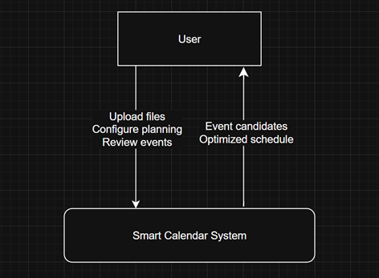
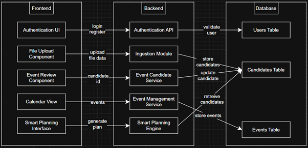
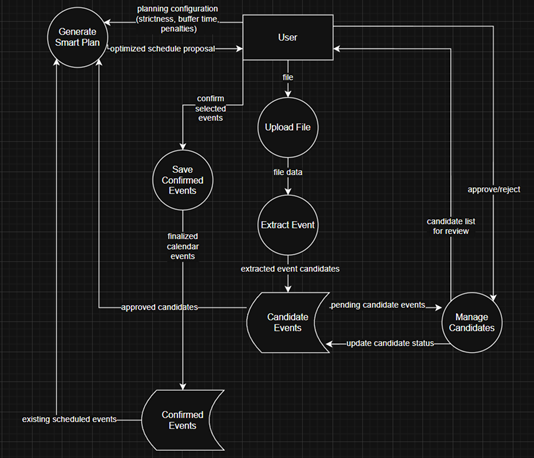

# Technical Specification

Table of contents

[Technical Specification ](#_Toc222500310)

[1\. Introduction ](#_Toc222500311)

[1.1 Overview ](#_Toc222500312)

[1.2 Glossary ](#_Toc222500313)

[2\. System Architecture ](#_Toc222500314)

[2.1 Architectural Overview ](#_Toc222500315)

[2.1.1 Frontend ](#_Toc222500316)

[2.1.2 Backend ](#_Toc222500317)

[2.1.3 Database ](#_Toc222500318)

[2.2 Distribution of Architectural Components ](#_Toc222500319)

[2.2.1 REACT Components: ](#_Toc222500320)

[2.2.2 Django Componens: ](#_Toc222500321)

[2.3 Architectural Integration of Smart Planning ](#_Toc222500322)

[2.4 External and Reused Components ](#_Toc222500323)

[2.5 A Brief Overview of Data Flow ](#_Toc222500324)

[3\. High-Level Design ](#_Toc222500325)

[3.1 System Context Diagram ](#_Toc222500326)

[3.2 Component Diagram ](#_Toc222500327)

[3.3 Data Flow Diagram ](#_Toc222500328)

[4\. Problems and Resolution ](#_Toc222500329)

[4.1 Regex-Based Event Extraction ](#_Toc222500330)

[4.2 Candidate and Confirmed Event State Management ](#_Toc222500331)

[4.3 Time Conflict Edge Cases ](#_Toc222500332)

[4.4 Sctrictness in Smart Planning ](#_Toc222500333)

[5\. Installation guide ](#_Toc222500334)

[5.1 Requirements ](#_Toc222500335)

[5.2 Backend setup ](#_Toc222500336)

[5.3 Frontend Installation ](#_Toc222500337)

# 1\. Introduction

## 1.1 Overview

This is a full-stack web application. It’s designed to extract events from a variety of sources and intelligently integrate them into the user’s calendar. Users are able to upload files like PDFs, images, or .ics files, which are then processed by the backend and turned into event candidates, which in turn are then added to the calendar, after being reviewed by the user.

One important feature of the system is Smart Planning. Smart Planning automatically optimizes the events in the users schedule based on their preferences like working hours, rescheduling permissions, strictness level, and penalties for conflicts. This scheduling logic and optimization is handled server-side.

Main Parts of the System:

1.  React frontend UI: communicates with the backend via REST API endpoints
2.  Django REST backend
3.  Database for storing users, events, and extracted candidates

## 1.2 Glossary

- **Candidate Event:** events that have been extracted from uploaded files but haven’t yet been approved
- **Existing Event:** events that are already stored in the user’s calendar
- **Smart Plan:** the optimized schedule created by our Smart Planning backend planning algorithm
- **Strictness Level:** A value that defines how aggressively the planner avoids conflicts/violations. This is set by the user
- **Penalty:** penalties are applied in the optimization alogrithm in order to better manipulate, and discourage negative outcomes (e.g.: conflicts)
- **Buffer Time:** minimum time that is required between the end of one event and the start of another

# 2\. System Architecture

## 2.1 Architectural Overview

Our system separates the user interface layer from the application logic layer and data management layer, meaning it follows client-server architecture, and by doing so it makes the system modular, scalable and more easily maintainable. Three primary layers can be found: (1) frontend application, (2) backend application server, (3) database.

### 2.1.1 Frontend

We used React to implement the frontend, which is responsible for handling all the user’s interactions, as well as providing an interface to authenticate, uploading files, review events, and visualize the calendar. Communication with the backend uses HTTP requests through RESTful API endpoints.

### 2.1.2 Backend

Django and REST Framework were used for the backend allowing the use of API endpoints. These deal with files ingestion, extracting events, detecting conflicts, logic for smart scheduling, and data. The server executes all business logic including validating events and Smart Planning algorithm.

### 2.1.3 Database

The database is used to store all persistent data like user accounts, documents that have been uploaded, event candidates, and events themselves. Using such database we ensure that data remains consistent and reliable across multiple sessions.

By separating layers in such a was we can ensure that presentation, business logic and storage of data are all managed independantly, which improves the robustness of the system and permits addi extensions in the future without the need for fundamental changes to the base architecture.

##   

## 2.2 Distribution of Architectural Components

### 2.2.1 REACT Components:

Structured by functional responsibility

Main modules: login, registration, file ingestion, event review, calendar display, smart planner

### 2.2.2 Django Componens:

Structured by logical modules, each of which has a dedicated REST endpoint, and define the structure of the database

Main Modulesingestion (processing uploads), candidate management (extracted events), event management (confirmed events), Smart Planning module (optimization)

## 2.3 Architectural Integration of Smart Planning

This works as a backend service that is invoked by the user through its API endpoints. The user requests plan generation and the frontend sends a configuration payload. This contains paramaters for the Smart Planner, which were defined by the user (e.g. strictness level, buffer time, working hours, etc.) After the backend receives these, it starts its optimization procedure which is based on penalties: it evaluates the candidate events, comparing them to existing ones and considering the constraints of the user, then based on the penalty system it computes a score and selects the option which minimizes this penalty. All of these functions are completed on the server which helps to keep performance consistant, meanwhile on the frontend the results are displayed to the user so that they can make any adjustments they might want.

## 2.4 External and Reused Components

Multiple third-party components were used as well as libraries, all in order to improve the development process:

As mentioned before React was used for the frontend component-based architecture. For the backend Django REST Framework provided structured API capabilities. And finally Axios was used as the HTTP client for communication between the two. These were reused as an infrastructure for the project while the rest of the domain-specific logic (like extracting events, detecting conflicts, etc.) was developed within the project.

## 2.5 A Brief Overview of Data Flow

Data flow begins by the user uploading a file, which is sent to the backend where it is processed (parsed and converted into event candidates), and are then stored in the database.

If the User chooses to initiate Smart Planning then any relevant data (existing events and pending candidates) are retreived from the aforementioned database to then be evaluated and optimized for scheduling. Once the user approves the new changes, candidates are turned into confirmed calendar events and are displayed on the frontend accordingly.

# 3\. High-Level Design

This section models the behaviour and data relationships of the system.

The system domains communicate through API calls and shared data models stored in the database.

## 3.1 System Context Diagram

The system interacts with the user, uploaded files, and the hosting platform (server), while the user only interacts with the frontend UI.

## 3.2 Component Diagram

Internal components and how they connect

## 3.3 Data Flow Diagram

Illustration of the movement of data between user, system processes, and data stores during file ingestion, event review, and smart schedule generation:

# 4\. Problems and Resolution

## 4.1 Regex-Based Event Extraction

One major challenge we faced involved extracting the information from the uploaded documents. Event data (titles, dates, locations, etc.) needed to be identified using regular expressions.

We initially used simple regex patterns to detect dates and time ranges, later however due to inconsistent formatting, varying date styles and irregular spacing, etc., some events were only partially extracted with missing or inaccurate information.

To solve this we refined the regex patterns to cover a wider variety of formatting variations, and we also added preprocessing to normalize whitespace and line breaks before the pattern matching began. However the most important step was to stor extracted data as candidate events rather than them being automatically scheduled, and this way we could minimize inaccuracies as well as allow the user the manually review and correct them.

## 4.2 Candidate and Confirmed Event State Management

Another major challenge arrose from adding candidates into the equation. At one point there was a potential of accidentally having approved candidates duplicated or incorrectly perceived (as unconfirmed candidates) when generating a smart plan.

We fixed this issue by using a stric lifecycle model that goes as follows: events are first stored as CandidateEvent objects which are only passed into the smart plannign module when the user approves them. They are also stored separately

## 4.3 Time Conflict Edge Cases

Conflict detection was a hard one to get right. We ran into many issues but one of them was that some events ended at the exact time the next one began this would lead to inconsistent results so we decided to implement certain time interval comparisons, that would make sure events are considered conflicting when their ranges overlaped beyond the defined boundaries. We named boundery buffer time and it is a value set by the user.

## 4.4 Sctrictness in Smart Planning

In order to work efficiently the smart planning feature needed to be flexible and practical at the same time. However finding a balace between the two was a challenge in itslelf. If the model was too strict, it would reject too many scheduling possibilities. If it was too leaniant it would produce inefficient and overloaded schedules, neither of which were desirable outcomes.

To keep the balance we implemented a penalty based evaluation model. This worked by instead of straight up rejecting a schedule it would assign penalties for undesireable conditions (conditions which were mostly set by the user), like for example not adhering to preferred hours, or conflicts with other events. This way a ranking was created of the possible schedules and the one with the lowest penalty score was selected

# 5\. Installation guide

The following guide assumes a Windows, macOS, or Linus environment with administrator access

## 5.1 Requirements

Software:

- Python(version 3.10 or later)
- Node.js (version 18 or later)
- npm (included with Node.js)
- Git (in case of repository cloning)

To verify installation run:

    $ python --version

    $ node --version

    $ npm --version

    $ git --version

If any of these commands fail, install the required software from their official websites

Hardware:

- 8GB RAM recommended
- 2GB free storage

If using git: Clone repository

    $ git clone https://gitlab.computing.dcu.ie/amaru.frisancho2/2026-csc1049-afrisancho-trobin.git

## Backend setup

1.  Navigate to backend folder

    $ cd code/backend

2.  Create and activate virtual environment:

    $ python -m venv venv

    (windows)

    $ venv\\Scripts\\activate

    (macOS/Linux)

    $ source venv/bin/activate

3.  Install dependencies:

    $ pip install -r requirements.txt

4.  Apply migrations:

    $ python manage.py makemigrations

    $ python manage.py migrate

5.  Run server:

    $ python manage.py runserver

## 5.3 Frontend Installation

1.  Navigate to frontend folder

    $ cd code/frontend

2.  Install dependencies:

    npm install

3.  Start frontend:

    npm start

Application runs on:

http://localhost:3000