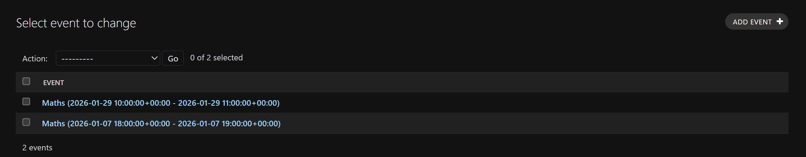
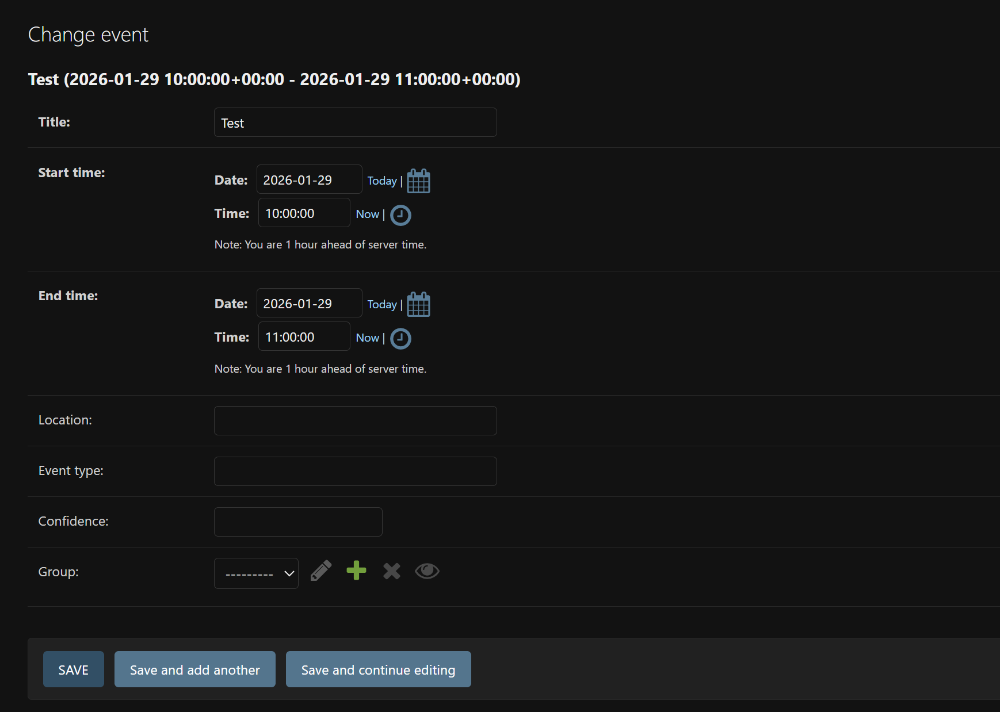
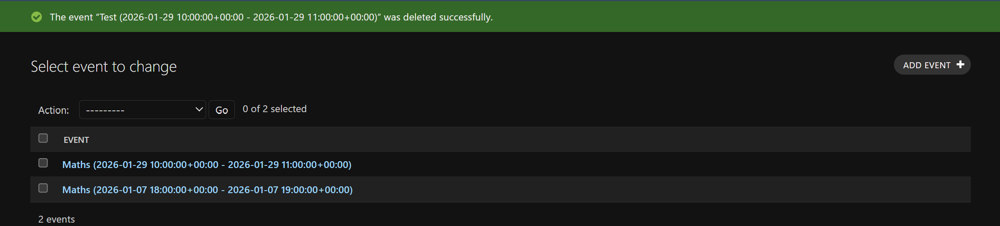
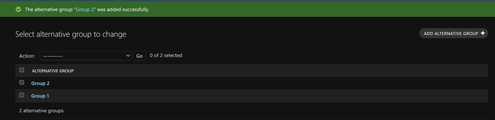
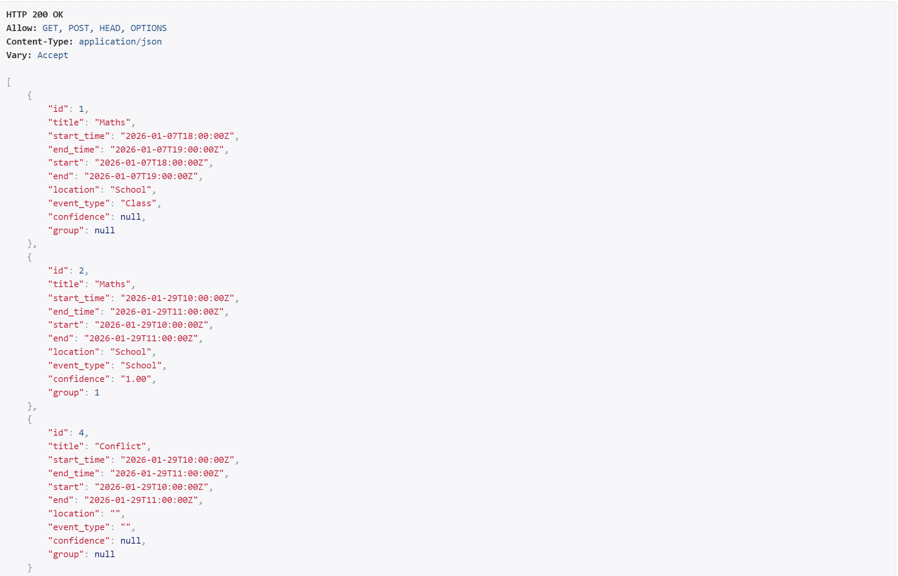
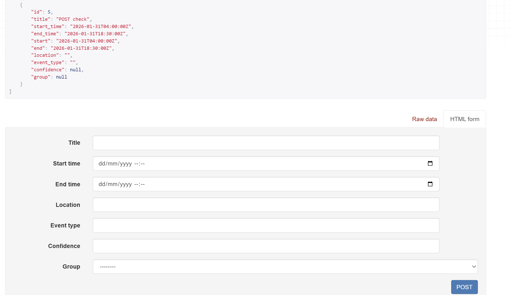
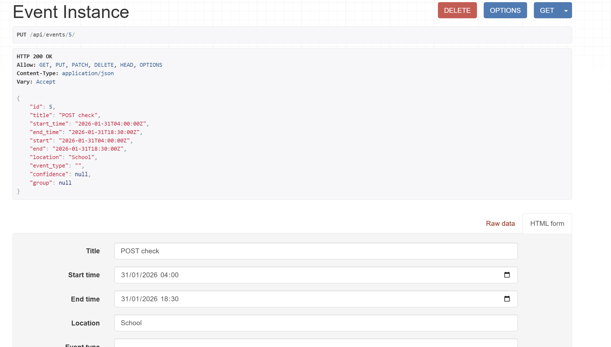
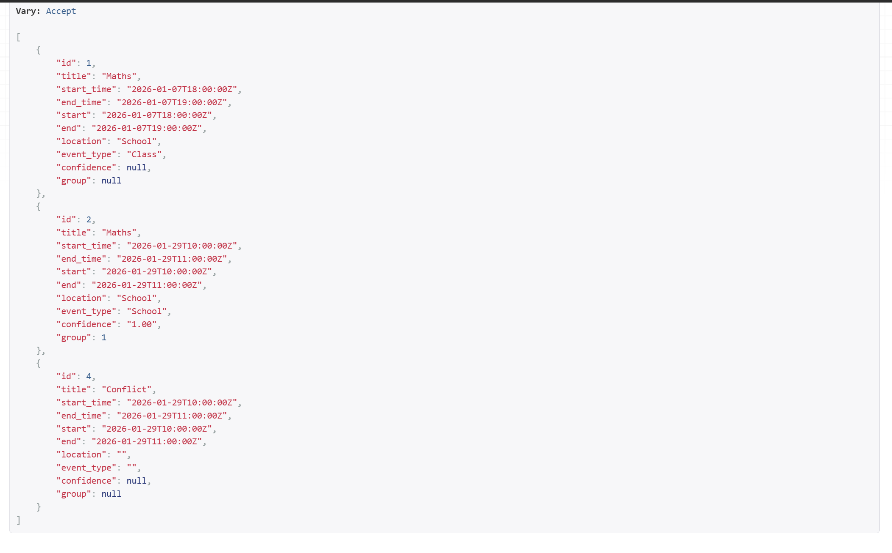
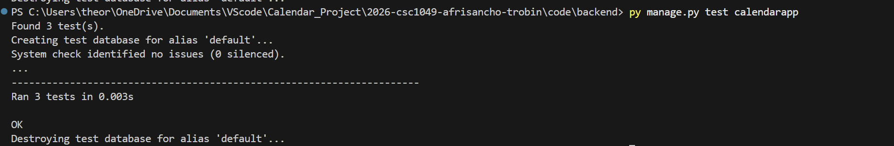

# Testing documentation
### This file shows our testing week by week in the format Week.ItemToTest.TestNumber (x.y.z)
for example, 1.1.2, shows week 1, function e.g. create event, test 2

## Week 1
The goal of week 1 was to get the django backend foundation working with the following models/functions:

### 1: Event

#### Test 1.1.1: Create event 

on http://localhost:8000/admin we can test it by creating an event. Information to input:  
Title: Maths  
Start time: 2026-01-29 
    Date:2026-01-29 
    Time:10 
End time:  
    Date: 2026-01-29 
    Time: 11 
Location: Room 14 
Event type: School 
Confidence: 1 
Group: Group 1 - class 

In the following screenshot, we can see the test worked:

#### Test 1.1.2: Testing different field requirements  
Since the minimum needed is title, start and end time, we need to test that event creation works with just the minimal information.
The result:

This work correctly. 

#### Test 1.1.3: Testing of deletion of events

Next we need to test if deletion of events work: EventDeletion

Take a look at the green notification. This proves there was an event called Test and it isn't there anymore

next we play around with omitting different unecessary information. for example, excluding location, eventy type, confidence and group at least once.
Similarly to the test where we omitted all unecessary information, they came back positive

### ConflictRecord

#### Test 1.2.1: Model testing (before logic)

Conflict Record is fairly simple to test at the moment as since we only have the model we have to create it ourselves like so:

The handling logic is not there yet, it is just that the fundamentals exist, so this test is to just make sure we can create the conflict record
You can also delete it as needed

### AlternativeGroup

#### Test 1.3.1: Grouping testing (also before UI logic)

Similar to ConflictRecord, we just need to know the model works. in the following screenshots you can see two groups with different names. One was created via
creation of an event, the other created manually.

This is working correctly and can also be deleted.

## Week 2
In week 2, we wanted to establish Api endpoints for creating, updating, deleting and listing events, as well as adding validation rules and error responses.

The outcome we wanted was essentially to create manual event management via api and that the backend is essentially functional without and UI.

### API endpoints

#### Test 2.1.1: Testing listing of events on api endpoint

Naturally, we will be testing these on the link: http://127.0.0.1:8000/events
this is the api endpoint name we have used. Firstly, we need to check to see if we can see the list of events and POST (create) an event.
So following this link we get the page and we can see the list of events:

This is confirmed to work

#### Test 2.1.2: Testing POST (creation of event)

To do this, we have to simply type in information on the POST section and check if its appended:

looking at event with id 5 named "POST check", we can see this worked. In the screenshot you can see where we POSTED the information from

#### Test 2.1.3 Testing updating events

Let's choose the event we just created at the following api endpoint http://127.0.0.1:8000/events/5 - the 5 being the id of the event.
Next lets add a location to update it called "School":

As you can see, this works fine

#### Test 2.1.4 Testing deletion of event

By following the same url as before, we will delete event with id 5:

And we are back to where we started in the event list, meaning deletion of events works fine.
That is all the api endpoints tested

### Validation rule testing

#### Test 2.2.1: tests.py file

For the validation rule testing, we have written code found in code/backend/calendarapp/tests.py

To run: python manage.py test calendarapp

This file tests that a title must be required, end time is after start time, and that an event can be created with the required details:

## Week 3
#### placeholder

