# Testing documentation
### This file shows our testing week by week in the format Week.ItemToTest.TestNumber (x.y.z)
for example, 1.1.2, shows week 1, function e.g. create event, test 2

### Types of Testing Used in order:

Unit testing: testing individual components such as models and validation logic using Django's testing framework

Integration testing: testing interaction between backend, database and frontend

Manual functional testing: manually testing features through UI and API endpoints

System testing: Testing the whole system

User testing: Getting people to test the system
## Week 1
The goal of week 1 was to get the django backend foundation working with the following models/functions:

### 1: Event: 

#### Test 1.1.1: Create event - Unit Test

on http://localhost:8000/admin we can test it by creating an event. Information to input:  
Title: Maths  
Start time: 2026-01-29 
    Date:2026-01-29 
    Time:10 
End time:  
    Date: 2026-01-29 
    Time: 11 
Location: Room 14 
Event type: School 
Confidence: 1 
Group: Group 1 - class 

In the following screenshot, we can see the test worked:

#### Test 1.1.2: Testing different field requirements   - Unit Test
Since the minimum needed is title, start and end time, we need to test that event creation works with just the minimal information.
The result:

This work correctly. 

#### Test 1.1.3: Testing of deletion of events - Unit Test

Next we need to test if deletion of events work: EventDeletion

Take a look at the green notification. This proves there was an event called Test and it isn't there anymore

next we play around with omitting different unecessary information. for example, excluding location, eventy type, confidence and group at least once.
Similarly to the test where we omitted all unecessary information, they came back positive

### ConflictRecord

#### Test 1.2.1: Model testing (before logic) - Unit Test

Conflict Record is fairly simple to test at the moment as since we only have the model we have to create it ourselves like so:

The handling logic is not there yet, it is just that the fundamentals exist, so this test is to just make sure we can create the conflict record
You can also delete it as needed

### AlternativeGroup

#### Test 1.3.1: Grouping testing (also before UI logic) - Unit Test

Similar to ConflictRecord, we just need to know the model works. in the following screenshots you can see two groups with different names. One was created via
creation of an event, the other created manually.

This is working correctly and can also be deleted.

## Week 2
In week 2, we wanted to establish Api endpoints for creating, updating, deleting and listing events, as well as adding validation rules and error responses.

The outcome we wanted was essentially to create manual event management via api and that the backend is essentially functional without and UI.

### API endpoints

#### Test 2.1.1: Testing listing of events on api endpoint - Unit Test

Naturally, we will be testing these on the link: http://127.0.0.1:8000/events
this is the api endpoint name we have used. Firstly, we need to check to see if we can see the list of events and POST (create) an event.
So following this link we get the page and we can see the list of events:

This is confirmed to work

#### Test 2.1.2: Testing POST (creation of event) - Unit Test

To do this, we have to simply type in information on the POST section and check if its appended:

looking at event with id 5 named "POST check", we can see this worked. In the screenshot you can see where we POSTED the information from

#### Test 2.1.3 Testing updating events - Unit Test

Let's choose the event we just created at the following api endpoint http://127.0.0.1:8000/events/5 - the 5 being the id of the event.
Next lets add a location to update it called "School":

As you can see, this works fine

#### Test 2.1.4 Testing deletion of event - Unit Test

By following the same url as before, we will delete event with id 5:

And we are back to where we started in the event list, meaning deletion of events works fine.
That is all the api endpoints tested

### Validation rule testing 

#### Test 2.2.1: tests.py file - Unit Test

For the validation rule testing, we have written code found in code/backend/calendarapp/tests.py
This containts automated unit tests

To run: python manage.py test calendarapp

This file tests that a title must be required, end time is after start time, and that an event can be created with the required details:

## Week 3

In week 3, the goal was to connect the Django backend API to a real user interface so that events could be visually displayed in a calendar instead of only through the admin panel or API endpoints.

The outcome we wanted was to confirm that events created in the backend can be dynamically retrieved and shown on a frontend calendar using FullCalendar.js.

### Frontend Calendar

#### Test 3.1.1: Testing calendar loads and displays events - Integration Test

We created a minimal React frontend using FullCalendar.js, served with react-scripts, which fetches events from the Django API and displays them in a monthly calendar.

The frontend is run using npm start, which starts the React development server at http://localhost:3000, while the Django backend runs at http://127.0.0.1:8000.

If everything works correctly, events stored in the database should appear visually in a monthly calendar.

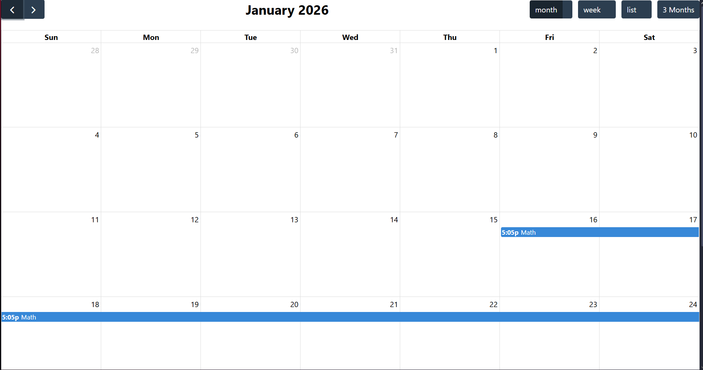

As shown above, the calendar successfully loads and displays events from the backend.

#### Test 3.1.2: Testing dynamic updates from backend to frontend - Integration Test

Next, we tested that new events created via the API or Django admin appear automatically in the calendar.

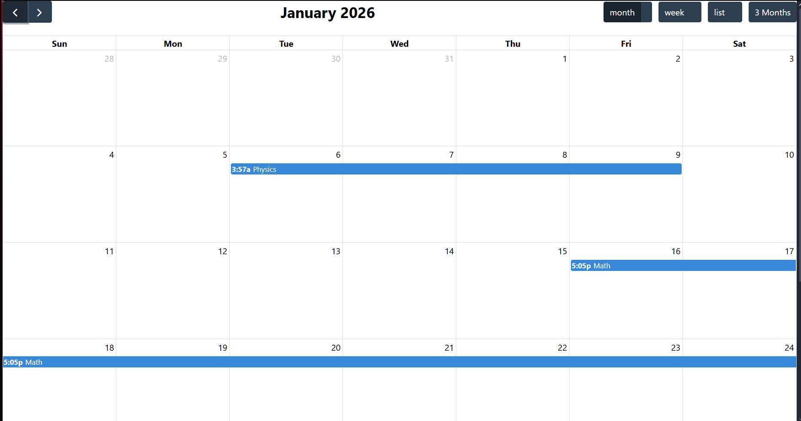

This proves the frontend is dynamically retrieving data from the backend.

And the same for deleting events.

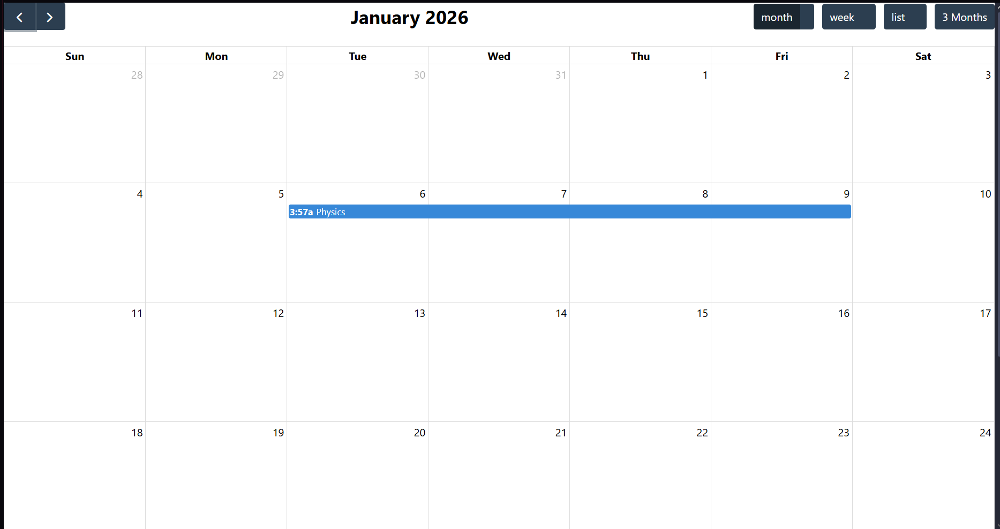

## Week 4

In week 4, the goal was to implement the file upload pipeline in the Django backend. This includes uploading files, storing them, processing them through the ingestion logic, and making the extracted data available.

Our aim was to enable file uploading successfully, store them in the backend, and process them so that extracted data exists in the system.

### File Upload & Ingestion 

#### Test 4.1.1: Testing file upload storage - Integration Test

We test whether files are being stored after upload.
We check if the file appears inside the media folder in the backend, as well as that a corresponding file record exists in the database (via Django admin)

The file appearing in the media directory confirms file storage is working correctly:

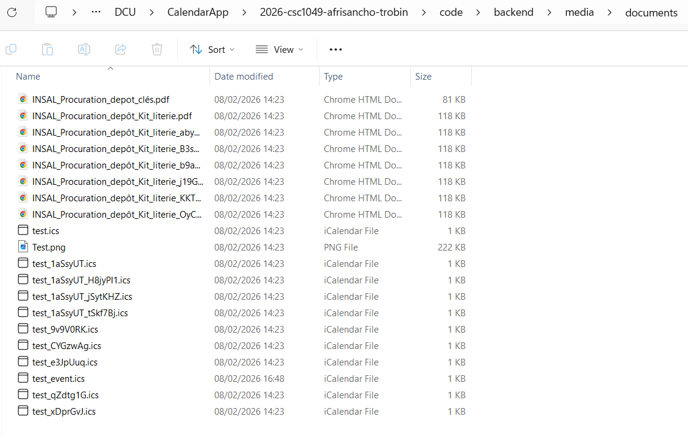

As well as in the database:

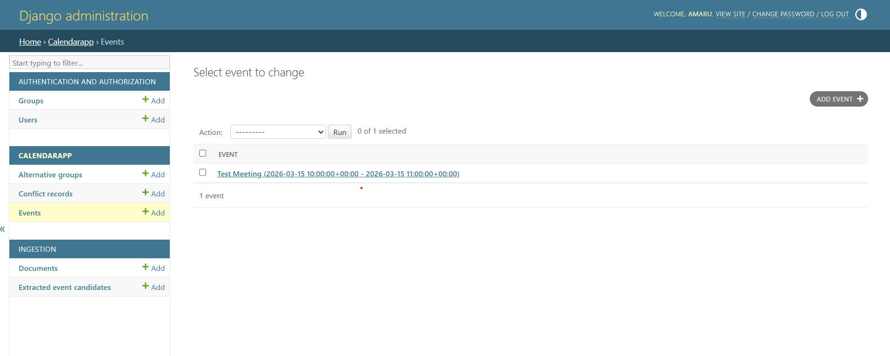

#### Test 4.1.2: Testing extracted data creation - Integration Test

After confirming the file uploads correctly, we check whether extracted data is created, specifically, we verify that a new ExtractedData entry is created in the system, as well as that the extracted content can be viewed (via API)

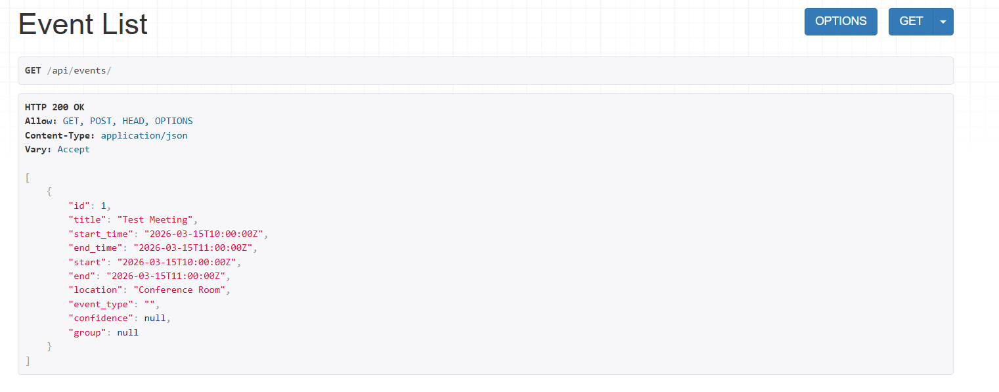

Confirming that the ingestion process works.

#### Test 4.1.3: Testing frontend file ingestion view - Integration Test

We test the frontend view of uploading a file. Specifically that a file can be selected and uploaded, as well as the extracted data can be reviewed in the interface.

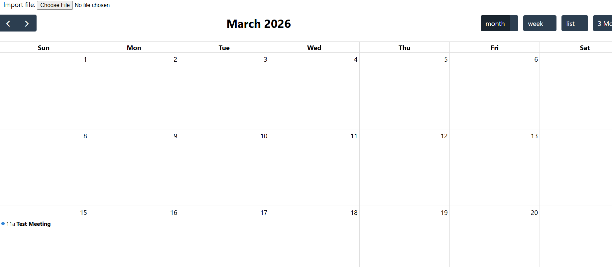

The extracted information appears on the frontend, confirming that the front- and backend are connected properly.

## Week 5

In week 5, we implemented converting file data into event candidates and allowing the user to validate them before creating real calendar events.

The goal was that the user coul review, edit, approve or reject the data extracted from uploaded files. 

If approved, a real Event is created in the system.

### Event Candidate Extraction

#### Test 5.1.1: Testing candidate creation from extracted data - Integration Test

After uploading a file and confirming ExtractedData exists (Test 4.1.2), we test whether event candidates are automatically generated from the extracted text.

We check that the event is created in the database, contains needed fields (title, start, end, etc.), and confidence score is stored.

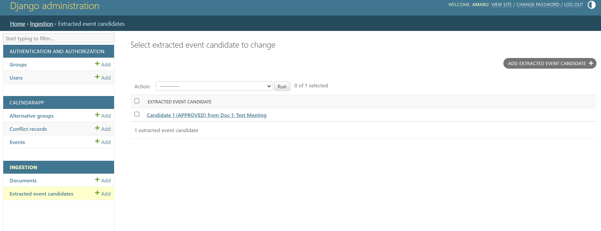

Confirming that the extracted text was successfully converted into structured event candidates.
This also confirms that candidate approval successfully creates a real calendar event.

### Candidate API Endpoints

#### Test 5.1.2: Testing approve candidate - Integration Test

See Test 5.1.1

#### Test 5.1.3: Testing reject candidate - Integration Test

Rejection works:

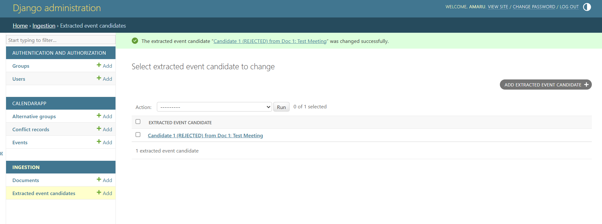

#### Test 5.1.4: Tesing edit candidate before approval - Integration Test

We test editing a candidate's fields before approving.

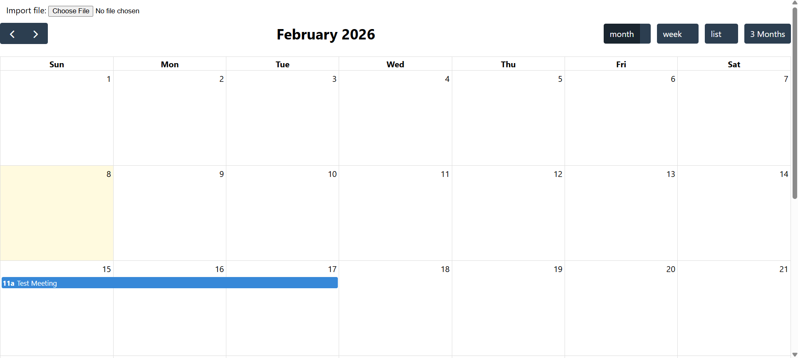

This confirms that the final Event matches the updated candidate data

#### Test 5.2.1: Testing validation page - Integration Test

1. Validation page appears:

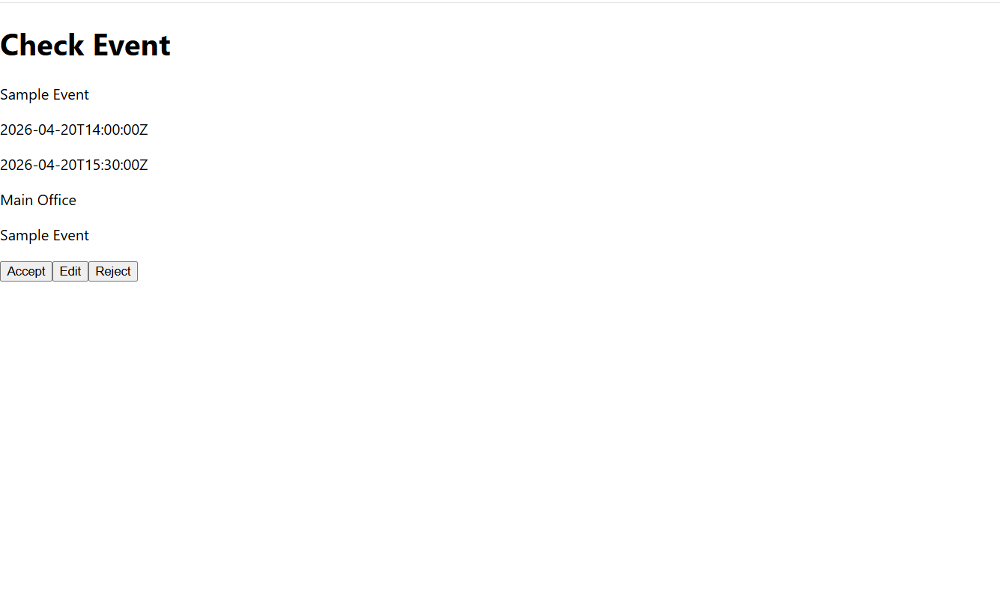

2. Rejection of an event does not create the event.

3. The event appears on the calendar after approval: 

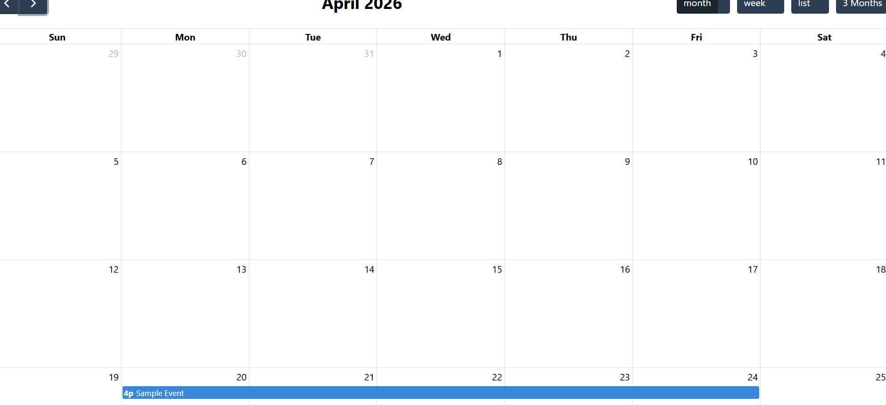

As well as on the backend:

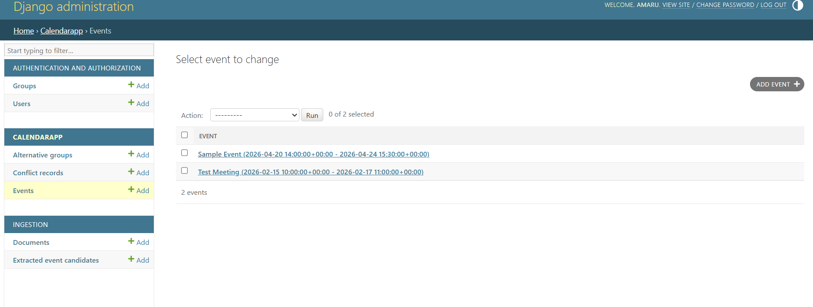

3. Editing an event:

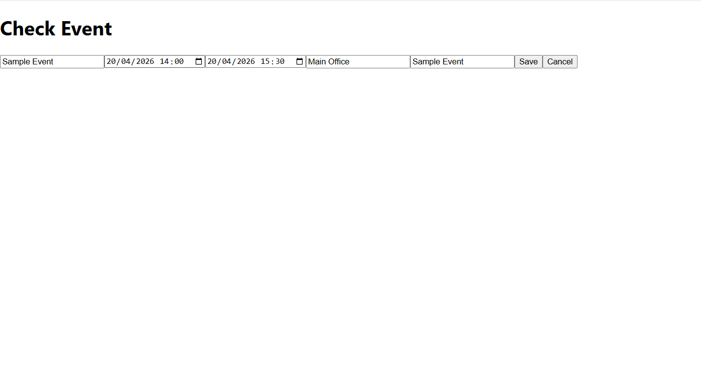

The validation page is fully functional
