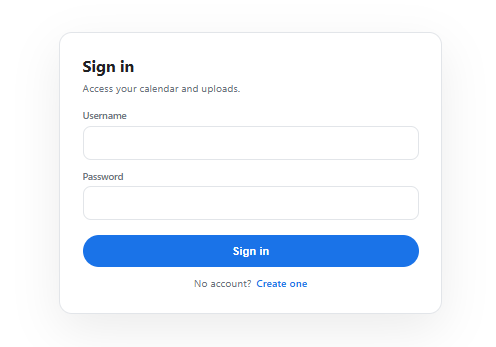
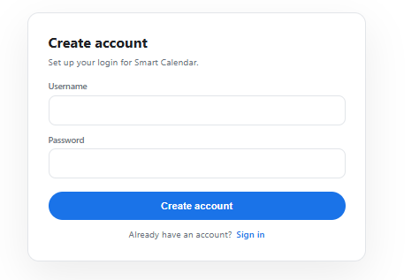
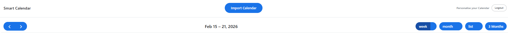
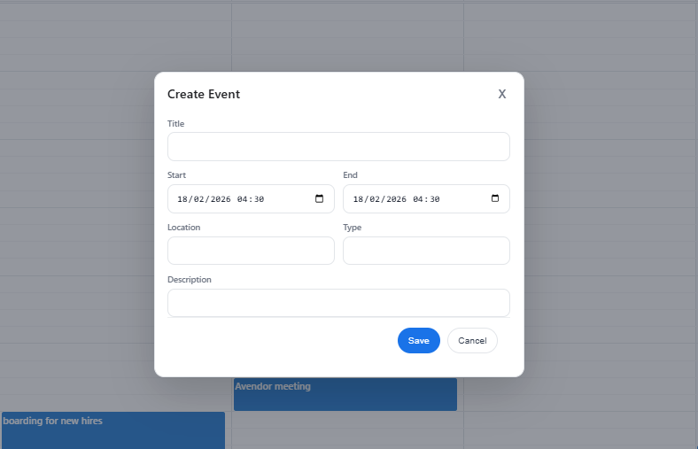
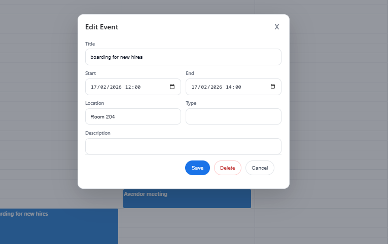
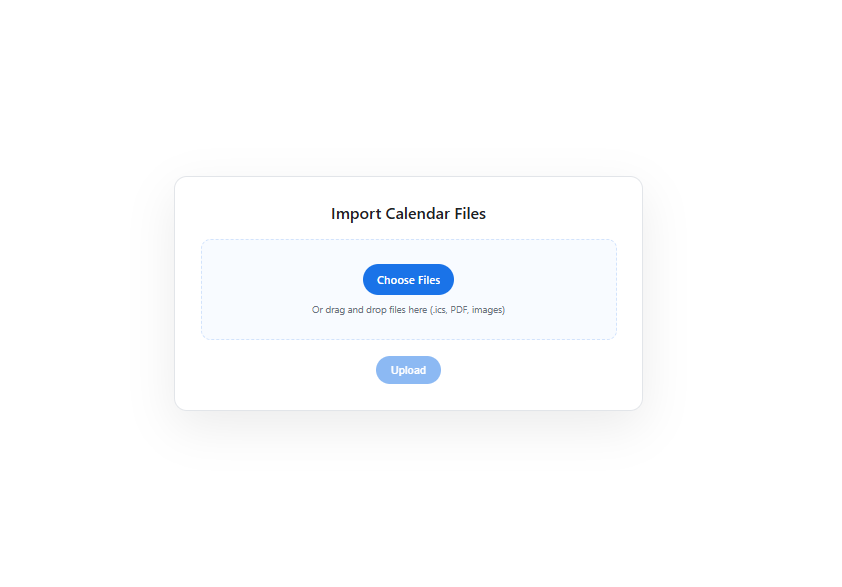
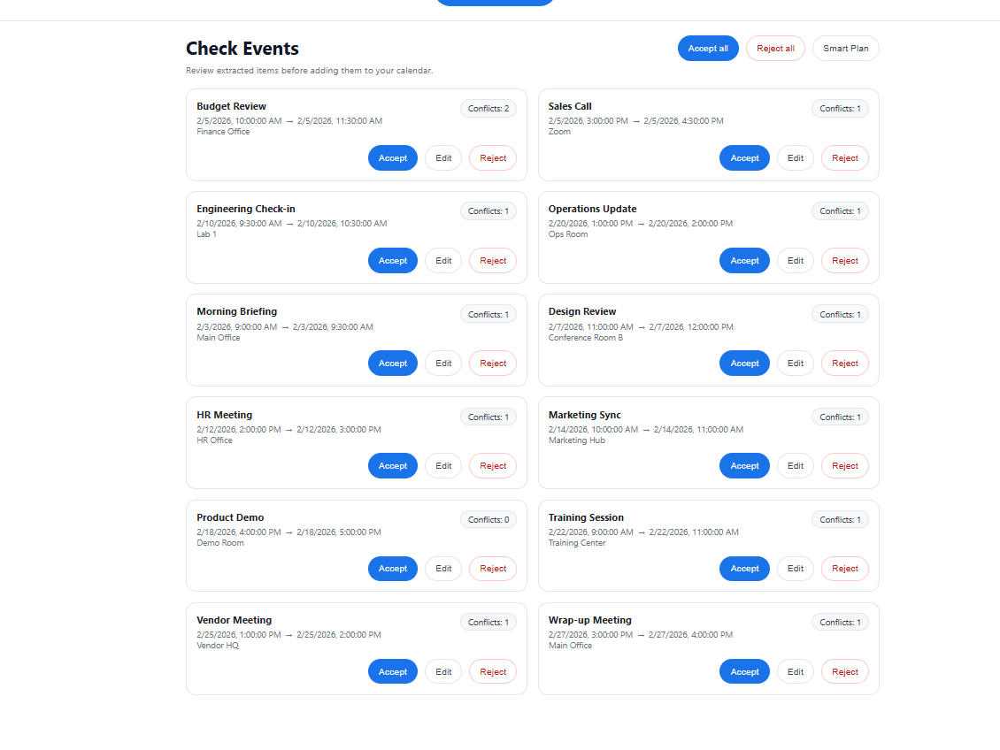
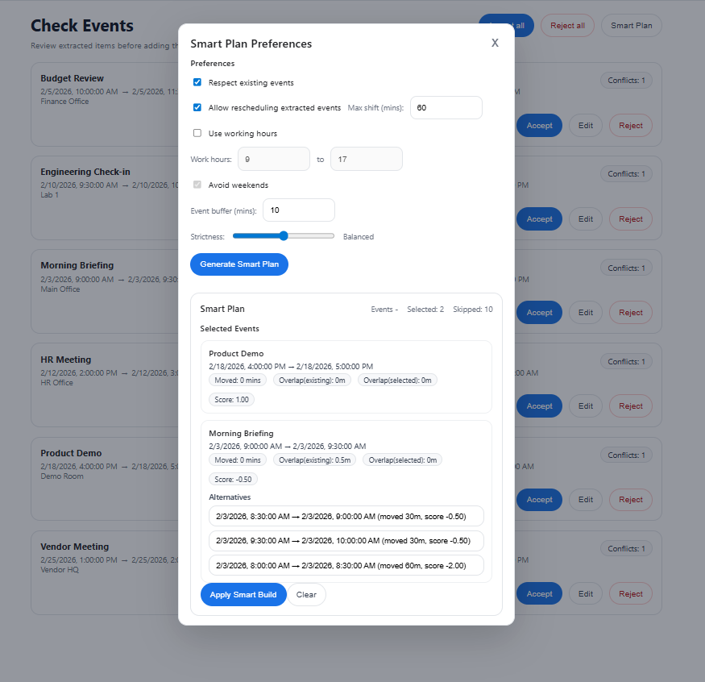

# User Manual
## Introduction

### Overview of the Project - Smart Calendar System

The Smart Calendar System is a scheduling app that is designed to help users organise events efficiently while reducing scheduling conflicts. 
The system allows users to manually create events, import events from documents, and automatically review and schedule extracted event data.

By combining traditional calendar functionality with intelligent document processing and scheduling, the Smart Calendar provides a solution for managing time and improving productivity.

## Purpose

The purpose of the Smart Calendar System is to provide users with a single platform to:

- Create and manage events
- Import events from documents
- Detect scheduling conflicts
- Automatically optimise event scheduling
- Maintain a personalised calendar experience

## Description

The system includes a calendar interface where users can manage events visually. Users can upload documents containing event information, 
which are analysed and converted into potential calendar events. These extracted events can then be reviewed, edited, approved, or rejected before being added to the calendar.

Additionally, a Smart Planning feature suggests scheduling based on user preferences and existing calendar events.

## Problem it Solves

Many users manage events across multiple sources such as emails, documents, and images. This creates challenges including:

- Missed Events
- Scheduling Conflicts
- Manual data entry effort
- Inefficient planning

The Smart Calendar System solves these problems by:

- Automatically extracting event information from documents
- Allowing users to review extracted events before approval
- Detecting overlapping events
- Providing intelligent scheduling recommendations

### Key Features

## Calendar event management

Users can create, edit, and delete events directly within the calendar interface. Events are displayed visually to provide a clear overview of schedules.

## Document upload and event extraction

The system allows users to upload documents containing event information. The system analyses these documents and extracts potential events for review.

## Event review and editing

Extracted events are displayed in a review interface where users can:

- Edit incorrect info
- Confirm event details
- Approve or reject events

## Conflict detection

The system automatically detects overlapping events and records conflicts to help users avoid scheduling issues.

## Smart planning recommendations

The Smart Planning feature suggests optimal scheduling arrangements that minimise conflicts and improve time management.

## User account login and personalised event storage

Users can create accounts and log in securely. Each user’s calendar and uploaded documents are private and stored separately.

### Getting Started

## Creating an account

To begin using the system:

1. Navigate to the registration page
2. Enter a username and password
3. Submit registration details
4. Log in using the created credentials

Figure: Login Page

Figure: Registration Page

### How to Navigate

The navigation bar provides quick access to major system features, including:

- Calendar view
- Document upload page
- Logout option

The Event review page and smart generation happen once users upload their documents and get extracted events

Figure: Navigation bar

### Managing Events

## Create Event

Users can create events by selecting an empty time slot on the calendar and entering event details such as title, time, location, and description.

Figure: Create event modal

## Edit Event

Existing events can be edited by selecting the event from the calendar and modifying the required details.

Figure: Edit event modal

## Deleting Events

Users can delete events directly from the edit interface. This removes the event from the calendar immediately.

### Uploading Documents

## Type of File(s)

The system supports multiple document formats, including:

- Ics Calendar files
- PDF documents
- Image files (PNG, JPG, JPEG, WEBP)

## Importing Events

Users can upload files by navigating to the upload page and selecting or dragging files into the upload area.

Figure: File upload interface

## Automatic Extraction

After uploading, the system automatically scans documents and extracts potential event information. Extracted events are saved as pending candidates awaiting user review.

### Reviewing Extracted Event Candidates

## Review

The review page displays extracted event candidates along with relevant details.
Users can:

- View extracted event data
- Edit event info
- Approve or reject events 

Figure: Event review interface

## Edit Event Candidate

Users may edit extracted event candidates to correct inaccurate information before approval.

### Approving events

## Accept

Approving an event adds it to the calendar and triggers conflict detection.

You have the option to accept one event at a time or all remaining extracted events

## Reject

Rejected events are removed from the review workflow and not added to the calendar.

You also can reject one or all like accept.

### Smart Planning

## Purpose

The Smart Planning feature automatically generates scheduling suggestions that optimise event placement.

## method

The system analyses:

- Existing events
- Event confidence levels
- Time conflicts
- User preferences

## Preferences

Users can adjust planning preferences such as:

- Working Hours
- Rescheduling and how much time to move events
- Work hours and use weekends
- Buffer time between events
- Considering existing events
- Strictness slider which determines the punishement of actions like rescheduling etc.

Figure: Smart planning interface

### Using Smart plan

## User Flow

1. Select document(s) in which to extract events
2. Open Smart Plan and configure planning preferences
3. Generate a plan
4. Review suggested schedule
5. Accept recommended event placements

### Conflict Detection
## Recorded

The system records overlapping events and alerts users to potential scheduling conflicts. This allows users to adjust events accordingly.

### Error Prevention

## File Upload

The system prevents unsupported file formats and ensures files are processed correctly.

## Event Details 

The system validates event information by ensuring that, at a minimum:

- Title is provided
- Start and end times are valid
- End time happens after start time

This prevents invalid events from being saved.